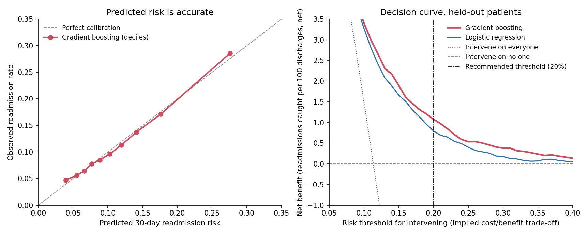

# Predicting 30-Day Hospital Readmission

Which diabetic inpatients should a care-management team call after discharge? Hospitals are penalized for excess 30-day readmissions, and a transitional-care team can only follow up with a fraction of discharged patients. This project builds a calibrated discharge-time risk score on 101,766 encounters from the UCI Diabetes 130-US Hospitals dataset and turns it into a triage rule.

**Recommendation:** call patients whose predicted 30-day readmission risk is **20% or higher**, about one discharge in ten. On held-out patients that list had a 28% readmission rate (2.5 times the 11.3% base rate) and reached 26% of all readmissions. The rule fits a team willing to make up to four unneeded calls per readmission it reaches; at that trade-off, acting on the score beats calling everyone or no one by 1.1 net readmissions reached per 100 discharges (95% CI 0.8 to 1.5).

## Key results

Held-out test set: 19,861 encounters from 13,998 patients who appear in neither training nor validation. 30-day readmission rate: 11.3%. Intervals are 95% patient-cluster bootstrap intervals (1,000 resamples).

| Model | ROC-AUC (95% CI) | PR-AUC (95% CI) | Brier score |
|---|---|---|---|
| Prevalence baseline | 0.500 | 0.113 | 0.101 |
| Logistic regression (L2) | 0.664 (0.650 to 0.679) | 0.215 (0.197 to 0.238) | 0.096 |
| **Gradient boosting (selected)** | **0.675 (0.661 to 0.691)** | **0.235 (0.213 to 0.259)** | **0.095** |

- **Model comparison:** gradient boosting was selected on validation ROC-AUC before the test set was scored. On test it beats logistic regression by 0.011 ROC-AUC, paired 95% CI 0.006 to 0.016.
- **Calibration:** calibration slope 1.00 and intercept 0.00 on held-out patients (ideal: 1 and 0), so a predicted 20% risk means about 20%.
- **Triage list:** the validation top-10% cutoff (risk 19.8%) flagged 10.5% of test discharges, with 28.0% precision (95% CI 25.7% to 30.5%) and 25.8% recall (23.2% to 28.8%).
- **Decision curve:** the model's net benefit exceeds calling everyone or no one at every risk threshold from 5% to 40% (`metrics/decision_curve.csv`).
- **Drivers:** discharge destination and prior-year inpatient stays dominate. Predicted risk rises from 9% with no prior stays to 23% with five or more, and is highest for transfers to a rehab facility (27%) and lowest for discharges home (10%) (`metrics/partial_dependence.csv`).



## Approach

- **Patient-disjoint 60/20/20 split.** 23% of patients have more than one encounter, accounting for 46% of all encounters. Splitting by `patient_nbr` (`GroupShuffleSplit`) keeps every patient in exactly one partition, so test performance isn't inflated by patients the model has already seen.
- **Discharge-time feature contract.** Only fields known at discharge are features. Identifiers are excluded. Encounters ending in death or hospice are removed because they can't be readmitted.
- **Clinically meaningful encoding.** Admission, discharge and source codes are categorical. ICD-9 diagnoses are grouped into the chapters used by Strack et al. (2014). "Test not performed" for HbA1c and glucose is its own category, not a missing value.
- **Two model families, tuned on validation only.** L2-regularized logistic regression (log-transformed, standardized counts; one-hot categories) and `HistGradientBoostingClassifier` with native categorical splits. Early stopping is off because its internal holdout splits by row; the number of boosting rounds is tuned on the patient-disjoint validation set instead. The test set is scored once.
- **Uncertainty that respects patient clustering.** A patient-cluster bootstrap gives intervals for each model and a paired interval for the difference between them.
- **Evaluation beyond AUC.** PR-AUC for the imbalanced outcome, Brier score, log loss, calibration slope and intercept, top-k% operating points with bootstrap intervals, permutation importance, partial dependence and subgroup diagnostics by gender, race and age.
- **Decision-curve analysis** (Vickers and Elkin, *Medical Decision Making*, 2006). Net benefit converts a risk threshold into an explicit exchange rate between reached readmissions and unneeded interventions, so the recommendation follows from a stated trade-off rather than from AUC.
- **Utilization features.** Total prior-year visits and the number of diabetes medications changed during the stay are added to the source fields. They changed test ROC-AUC by less than 0.001, so the gains here come from the encoding and the model, not from feature engineering.

## Data

- **Source:** [Diabetes 130-US Hospitals for Years 1999-2008](https://archive.ics.uci.edu/dataset/296/diabetes+130-us+hospitals+for+years+1999-2008), UCI Machine Learning Repository, DOI [10.24432/C5230J](https://doi.org/10.24432/C5230J). License: CC BY 4.0.
- **Size:** 101,766 inpatient encounters of diabetic patients from 130 US hospitals, 1999 to 2008. 99,343 encounters from 69,990 patients remain after excluding death and hospice discharges.
- **Unit of analysis:** one encounter, scored at discharge. Target: readmitted in under 30 days.
- The file in `data/` is the unmodified UCI CSV (gzipped). Checksums and rebuild steps are in [DATA_PROVENANCE.md](DATA_PROVENANCE.md).

## Repository structure

```
├── modeling.py                              # data contract, split, models, evaluation, figures
├── hospital_readmission_prediction.ipynb    # walkthrough of the analysis with outputs
├── data/                                    # UCI source file and code tables
├── metrics/                                 # every reported number (JSON and CSV)
├── figures/                                 # decision curve, ROC/calibration, drivers
└── tests/                                   # split, loader, bootstrap and calibration tests
```

## Reproduce

```bash
python3.12 -m venv .venv && source .venv/bin/activate
pip install -r requirements.txt
python modeling.py          # about 4 minutes; rewrites metrics/ and figures/
pytest -q
jupyter nbconvert --to notebook --execute --inplace hospital_readmission_prediction.ipynb
```

Results are deterministic: a rerun reproduces every file in `metrics/` byte for byte.

## Limitations

- Discrimination is modest (ROC-AUC 0.675). The data are administrative: no labs beyond HbA1c and glucose flags, no vitals, social factors or post-discharge information, which caps what any model can learn.
- The source has no hospital identifier or admission dates, so the model can't be validated across sites or forward in time. Performance in a different hospital or a later period is unknown.
- Readmissions to other hospitals aren't captured, so the target undercounts true readmissions.
- Discrimination varies by subgroup: ROC-AUC is 0.631 for patients aged 80 to 90 and 0.544 for those 90 and over (481 test encounters), versus 0.66 to 0.78 for younger age bands. Average predicted risk matches the observed rate within 1.5 points in every age band (`metrics/subgroup_metrics.csv`), but the triage list ranks the oldest patients less reliably.
- The 20% rule assumes a team values one reached readmission at four unneeded calls. A team with a different trade-off should read its threshold off the decision curve; the model stays ahead of the defaults from 5% to 40%.
- Importance and partial dependence describe what the model uses to predict, not what causes readmission.
